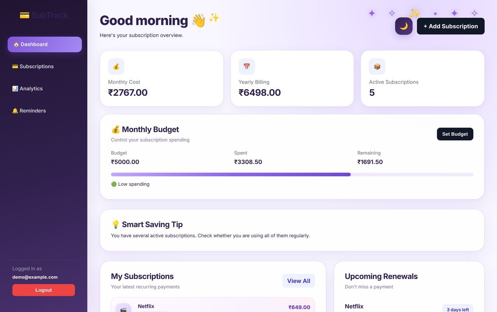
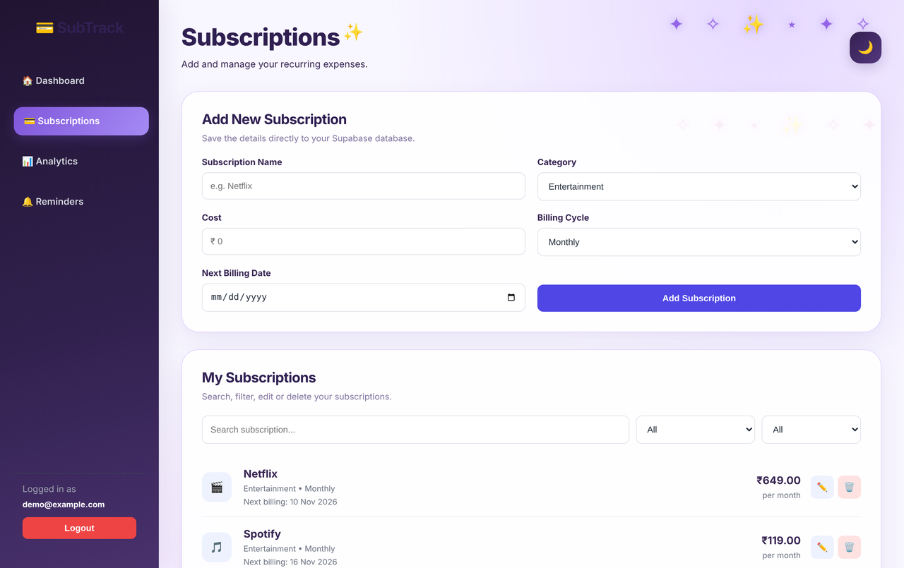
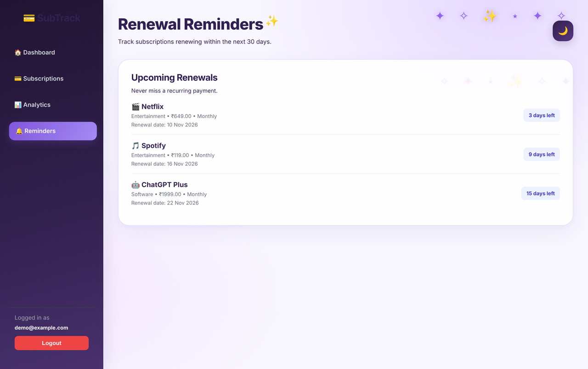

<div align="center">

# SubTrack

**A subscription expense tracker with secure accounts, budgets, analytics and renewal reminders.**


</div>

---

## Overview

SubTrack is a multi-page web app that keeps all of a person's recurring payments in one place: streaming services, software, courses and memberships. Each user signs in with their own account, adds their subscriptions, and instantly sees what they spend each month and year, which renewals are coming up, and whether they are staying within a monthly budget.

It is built with plain HTML, CSS and JavaScript (no framework) on top of **Supabase** for authentication and a PostgreSQL database.

## Problem Statement

Subscriptions are easy to start and easy to forget. Small monthly charges spread across many apps add up, renewal dates slip by unnoticed, and yearly plans renew before you remember to cancel them. SubTrack gives a single, private view of every recurring payment, its next billing date, and its share of your spending.

## Features

**Accounts and security**
- Sign up, log in and log out with email and password (Supabase Auth)
- Handles email confirmation: tells the user to confirm their email when the project requires it
- Forgot-password and reset-password flow using a secure email link
- Every app page is protected: signed-out visitors are sent to the login page, and signed-in users skip the login and sign-up pages
- Each user only works with their own records (enforced by Row Level Security in the database, see [Database Design](#database-design))

**Subscriptions**
- Add a subscription with name, category, cost, billing cycle (Monthly or Yearly) and next billing date
- Categories: Entertainment, Education, Software, Shopping, Fitness, Other
- Edit the name, cost and next billing date, or delete a subscription with confirmation
- Search by name and filter by category and billing cycle
- Recognisable icons for common services (Netflix, Spotify, YouTube, Amazon Prime, ChatGPT and more)

**Dashboard**
- Totals for monthly-billed and yearly-billed subscriptions, plus the number of active subscriptions
- Latest subscriptions and the next five upcoming renewals with a days-left countdown
- Monthly budget card with a progress bar and a spending status (low, getting high, over budget)
- A rule-based saving tip that reacts to your budget and number of subscriptions

**Analytics**
- Pie chart of monthly-equivalent spending by category (yearly plans are divided by 12)
- Bar chart of the monthly-equivalent cost of each subscription
- Category breakdown with progress bars, and an estimated annual cost

**Reminders and settings**
- Reminders page listing every renewal due in the next 30 days ("Renewing today", "Tomorrow", "N days left")
- Light and dark mode toggle

## Screenshots

> Rendered locally from this repository with sample subscriptions.

| Dashboard | Subscriptions |
|---|---|
|  |  |

| Renewal reminders |
|---|
|  |

## Tech Stack

| Layer | Technology |
|---|---|
| Frontend | HTML5, CSS3, vanilla JavaScript |
| Authentication | Supabase Auth (email and password, password recovery) |
| Database | Supabase PostgreSQL with Row Level Security |
| Charts | Chart.js 4.5.1 (loaded from jsDelivr) |
| Client library | `@supabase/supabase-js` v2 (loaded from jsDelivr) |

## Project Structure

```text
subtrack-subscription-expense-tracker/
├── index.html             # dashboard: totals, budget, saving tip, latest subscriptions, renewals
├── subscriptions.html     # add, search, filter, edit and delete subscriptions
├── analytics.html         # category and billing charts
├── reminders.html         # renewals due in the next 30 days
├── login.html             # sign in
├── signup.html            # create an account
├── forgot-password.html   # request a password reset email
├── reset-password.html    # set a new password from the email link
├── supabase-config.js     # Supabase project URL and publishable key
├── auth.js                # sign-up, login, logout and page protection
├── script.js              # data loading, rendering, budget, analytics, reminders, dark mode
├── style.css              # layout, components, light and dark themes
├── package.json           # lists chart.js (the pages load it from a CDN)
└── screenshots/           # images used in this README
```

## Installation and Setup

**Prerequisites:** a free [Supabase](https://supabase.com) account and a modern browser. Python is only used to run a simple local web server.

1. **Clone the repository**
   ```bash
   git clone https://github.com/MohammedShareef3527/subtrack-subscription-expense-tracker.git
   cd subtrack-subscription-expense-tracker
   ```
2. **Create a Supabase project**, then open **SQL Editor** and run the schema from [Database Design](#database-design).
3. **Configure authentication** in Supabase under **Authentication → URL Configuration**:
   - Site URL: the address you will open the app on (for local use, `http://localhost:5500`)
   - Redirect URLs: add `http://localhost:5500/reset-password.html` so password-reset emails work
4. **Add your project keys** to `supabase-config.js` (see [Configuration](#configuration)).
5. **Start a local web server from the project folder.** The pages use links such as `/login.html`, so open them through a server rather than double-clicking the files:
   ```bash
   python -m http.server 5500
   ```
   VS Code's Live Server extension also works.
6. Open `http://localhost:5500/signup.html`, create an account, and start adding subscriptions.

## Configuration

All configuration lives in `supabase-config.js`:

| Value | Where to find it |
|---|---|
| `SUPABASE_URL` | Supabase Dashboard → Project Settings → API → Project URL |
| `SUPABASE_ANON_KEY` | Supabase Dashboard → Project Settings → API → publishable (anon) key |

The publishable key is designed to be used in the browser. Your data stays private because Row Level Security restricts every query to the signed-in user. **Never** put the `service_role` or secret key in this file or anywhere in the frontend.

The monthly budget (default ₹5,000) and the dark-mode choice are saved in the browser's `localStorage`. They are not stored in Supabase.

## How It Works

1. **Loading Supabase.** Every page loads `supabase-js` from a CDN, then `supabase-config.js` creates one shared `supabaseClient`.
2. **Protecting pages.** `auth.js` runs on each page. On app pages, `protectAppPage()` calls `supabase.auth.getUser()` and redirects to `login.html` if nobody is signed in. On the login and sign-up pages, a signed-in user is sent straight to the dashboard.
3. **Loading data.** `script.js` fetches the user's rows from the `subscriptions` table, newest first, and maps database columns (`billing_cycle`, `next_billing_date`) to the field names the UI uses.
4. **Rendering.** One shared `updateAll()` function refreshes whatever sections exist on the current page: summary cards, lists, renewals, analytics and reminders. All user-entered text is escaped before it is inserted into the page.
5. **Calculations.** Yearly plans are divided by 12 for monthly-equivalent figures. Days left are calculated from today's date to `next_billing_date`.
6. **Writing data.** Add, edit and delete call `insert`, `update` and `delete` on the `subscriptions` table, then update the in-memory list so the page refreshes without a reload.
7. **Password reset.** `forgot-password.html` calls `resetPasswordForEmail()` with a redirect to `reset-password.html`, which checks for a valid recovery session before calling `updateUser({ password })`.

## Database Design

The app uses a single table linked to Supabase's built-in `auth.users` table.

```text
auth.users (managed by Supabase)
   │ 1
   │
   │ many
public.subscriptions
```

| Column | Type | Notes |
|---|---|---|
| `id` | `uuid` | primary key |
| `user_id` | `uuid` | owner, references `auth.users(id)` |
| `name` | `text` | service name |
| `category` | `text` | Entertainment, Education, Software, Shopping, Fitness or Other |
| `cost` | `numeric` | amount per billing cycle, in ₹ |
| `billing_cycle` | `text` | `Monthly` or `Yearly` |
| `next_billing_date` | `date` | next renewal |
| `created_at` | `timestamptz` | used to sort newest first |

The SQL file is not part of this repository. The schema below matches the columns the code reads and writes. If you already have a live project, compare it with your existing table before running anything.

```sql
create table if not exists public.subscriptions (
  id uuid primary key default gen_random_uuid(),
  user_id uuid not null default auth.uid() references auth.users (id) on delete cascade,
  name text not null,
  category text not null default 'Other',
  cost numeric(10, 2) not null check (cost > 0),
  billing_cycle text not null check (billing_cycle in ('Monthly', 'Yearly')),
  next_billing_date date not null,
  created_at timestamptz not null default now()
);

alter table public.subscriptions enable row level security;

create policy "Users can read their own subscriptions"
  on public.subscriptions for select using ((select auth.uid()) = user_id);

create policy "Users can add their own subscriptions"
  on public.subscriptions for insert with check ((select auth.uid()) = user_id);

create policy "Users can update their own subscriptions"
  on public.subscriptions for update
  using ((select auth.uid()) = user_id) with check ((select auth.uid()) = user_id);

create policy "Users can delete their own subscriptions"
  on public.subscriptions for delete using ((select auth.uid()) = user_id);
```

## Limitations

- The budget is stored per browser, so it does not follow you to another device.
- Reminders are shown inside the app only. No emails or push notifications are sent.
- Editing changes the name, cost and next billing date. To change the category or billing cycle, delete the subscription and add it again.
- Amounts are shown in Indian Rupees (₹).

## Future Improvements

These are planned ideas, not current features:

- Email reminders before a renewal, using a Supabase Edge Function on a schedule
- Save the monthly budget in Supabase so it syncs across devices
- Edit every field, including category and billing cycle
- Automatically move `next_billing_date` forward after a renewal date passes
- Export subscriptions to CSV
- Currency selection

## Learning Outcomes

- Building a complete authentication flow with Supabase Auth: sign-up, email confirmation, login, logout and password recovery
- Securing multi-user data with PostgreSQL Row Level Security instead of trusting the frontend
- CRUD operations with `supabase-js` and mapping database columns to UI models
- Structuring a multi-page vanilla JavaScript app that shares one script and only renders the sections present on each page
- Preventing XSS by escaping user input before rendering HTML
- Date arithmetic for renewal countdowns and monthly-equivalent cost calculations
- Data visualisation with Chart.js
- Collaborating through branches and pull requests on GitHub

## Author

**Mohammed Shamsul Qhadri Shareef**
GitHub: [@MohammedShareef3527](https://github.com/MohammedShareef3527)

UI theme ("dreamy lavender") contributed by [@falak-pasha](https://github.com/falak-pasha) in pull request #2.
